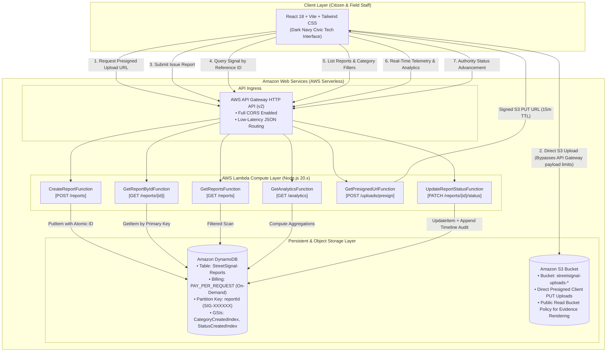

# StreetSignal 🚨

> **Enterprise-Grade Civic Issue Reporting & Dispatch Platform**  
> Built with **React + Vite + Tailwind CSS**, **AWS API Gateway**, **AWS Lambda**, **Amazon DynamoDB**, **Amazon S3**, and **AWS SAM**.


-blue?style=flat-square&logo=awslambda)
-blueviolet?style=flat-square&logo=amazondynamodb)
-red?style=flat-square&logo=amazons3)


---

## 🌟 Executive Summary

**StreetSignal** is a modern, high-performance civic technology platform enabling citizens to report urban defects with minimal friction and maximum transparency. Whether reporting hazardous potholes, illegal garbage dumping, unpaved road dust, ruptured municipal water pipes, or dark streetlights, citizens receive an instant unique reference ID (`SIG-XXXXXX`) to monitor field crew dispatches and status resolutions.

Designed strictly around **AWS Serverless Well-Architected principles**, StreetSignal leverages on-demand database scaling, direct S3 presigned photo uploads, sub-millisecond HTTP routing via API Gateway, and least-privilege IAM policies packaged as code with AWS SAM.

---

## 🏗 System Architecture



---

## 🚀 Key Functional Capabilities

1. **Premium Civic Tech Interface**:
   - Built with dark navy backgrounds (`#070b14`, `#0a0f1d`), crisp typography, and electric-blue accents (`#00f0ff`, `#38bdf8`).
   - Mobile-first, fully responsive design with zero visual clutter or gratuitous animations.

2. **Official Civic Categories**:
   - ⚠️ **Potholes**: Road craters, surface cracks, sunken asphalt, or hazardous potholes.
   - 🗑️ **Garbage**: Overflowing commercial bins, roadside litter, or uncollected waste.
   - 💨 **Road Dust**: Construction silt, unpaved shoulders, and airborne particulate hazards.
   - 💧 **Water Leakage**: Subterranean pipeline ruptures, valve leaks, or severe waterlogging.
   - 💡 **Streetlights**: Dark streetlamps, flickering bulbs, and electrical junction outages.

3. **Unique Memorable Tracking IDs**:
   - Generates human-friendly 6-digit reference IDs (e.g. `SIG-842910`, `SIG-155566`) with collision resistance and 1-click clipboard copying.

4. **Secure Direct S3 Presigned Uploads**:
   - Photographs are uploaded directly from the browser to Amazon S3 via authenticated presigned PUT URLs, preventing API Gateway payload timeouts and saving Lambda execution costs.
   - Strict client and server-side validation: formats restricted to JPEG, PNG, and WebP; maximum file size capped at 5MB.

5. **Real-Time Lifecycle Tracking**:
   - Visual 4-step progress stepper: `Submitted` ➔ `Under Review` ➔ `In Progress` ➔ `Resolved`.
   - Complete audit history with timestamps and dispatch notes.

6. **Interactive Municipal Operations Dispatcher**:
   - Built-in status progression tool allowing evaluators and municipal officers to update issue statuses in DynamoDB and inspect live changes.

7. **Executive Analytics Dashboard**:
   - Real-time aggregation of total reports, category distributions, resolution rates, and locality density leaderboards.

---

## 📁 Repository Structure

```
StreetSignal/
├── backend/
│   ├── src/
│   │   ├── handlers/
│   │   │   ├── createReport.js        # POST /reports (Validation, ID generation, DynamoDB write)
│   │   │   ├── getReports.js          # GET /reports (List with category, locality, status filters)
│   │   │   ├── getReportById.js       # GET /reports/{id} (Fetch by reference ID)
│   │   │   ├── getAnalytics.js        # GET /analytics (Summary statistics & locality metrics)
│   │   │   ├── getPresignedUrl.js     # POST /uploads/presign (S3 PutObject presigned URL)
│   │   │   └── updateReportStatus.js  # PATCH /reports/{id}/status (Advance status & append audit log)
│   │   ├── services/
│   │   │   ├── dynamoService.js       # AWS SDK v3 DynamoDB DocumentClient wrapper + fallback
│   │   │   └── s3Service.js           # AWS SDK v3 S3 client & presigner wrapper
│   │   ├── utils/
│   │   │   ├── response.js            # Standardized HTTP/CORS JSON response formatting
│   │   │   ├── validator.js           # Strict input, category, and file-size validation
│   │   │   └── idGenerator.js         # Unique reference ID generator (SIG-XXXXXX)
│   │   └── local-server.js            # Express server mapping Lambda handlers for local dev
│   ├── tests/
│   │   ├── validator.test.js          # Unit tests for category, size, and text rules
│   │   ├── idGenerator.test.js        # Unit tests for SIG-XXXXXX uniqueness and formatting
│   │   └── handlers.test.js           # End-to-end unit tests for all Lambda handlers
│   └── package.json
├── frontend/
│   ├── src/
│   │   ├── components/
│   │   │   ├── Navbar.jsx             # Dark navy header with live beacon & navigation
│   │   │   ├── Hero.jsx               # Landing banner, quick search, and architecture badges
│   │   │   ├── ReportForm.jsx         # 5-category submission form, photo upload, GPS locator
│   │   │   ├── TrackReport.jsx        # Reference ID lookup, 4-step stepper, status simulator
│   │   │   ├── AnalyticsDashboard.jsx # Metrics cards, category charts, locality insights
│   │   │   ├── ReportList.jsx         # Filterable live feed of civic issues
│   │   │   ├── ReportCard.jsx         # Compact card with category badge, photo thumbnail
│   │   │   ├── StatusBadge.jsx        # Color-coded glowing status pill
│   │   │   └── Footer.jsx             # Civic tech footer with architecture specifications
│   │   ├── services/
│   │   │   └── api.js                 # API client with S3 direct upload & local proxy
│   │   ├── utils/
│   │   │   └── categories.js          # Category metadata, colors, and descriptions
│   │   ├── App.jsx                    # Root state router
│   │   ├── index.css                  # Custom Tailwind styles & electric-blue glow
│   │   └── main.jsx
│   ├── index.html
│   ├── vite.config.js
│   ├── tailwind.config.js
│   └── package.json
├── docs/
│   └── architecture.md                # Cloud architecture deep-dive & sequence flows
├── template.yaml                      # AWS SAM Infrastructure as Code template
├── package.json                       # Monorepo scripts
└── README.md                          # Comprehensive documentation
```

---

## ⚡ Quickstart (Local Development & Testing)

You can run and test StreetSignal locally in under 60 seconds without needing AWS credentials configured:

### 1. Clone & Install Dependencies

```bash
# Clone the repository
cd StreetSignal

# Install backend dependencies
cd backend
npm install

# Install frontend dependencies
cd ../frontend
npm install

# Return to root
cd ..
```

### 2. Run the Unit Test Suite

The backend includes a comprehensive test suite (18 unit tests) using Node.js built-in test runner:

```bash
cd backend
npm test
```

Expected output:
```
▶ Lambda Handlers End-to-End
  ✔ POST /reports - should successfully create a new civic report
  ✔ POST /reports - should reject invalid category
  ✔ GET /reports - should list reports including newly created one
  ✔ GET /reports/{id} - should retrieve created report by ID
  ✔ GET /reports/{id} - should return 404 for non-existent report ID
  ✔ GET /analytics - should return aggregated counts and distribution
  ✔ POST /uploads/presign - should generate signed upload URL for valid image
▶ Report ID Generation
  ✔ should generate IDs with SIG- prefix followed by 6 characters/digits
  ✔ should generate unique IDs across multiple invocations
  ✔ should validate valid and invalid formats correctly
▶ Report Input Validation
  ✔ should accept valid report data for all official categories
  ✔ should reject invalid or unsupported category
  ✔ should reject short locality under 2 characters
  ✔ should reject short description under 5 characters
  ✔ should reject excessively long description exceeding 1500 chars
▶ Presigned S3 Upload Validation
  ✔ should accept valid image MIME types and safe file name
  ✔ should reject disallowed file types (e.g. application/pdf)
  ✔ should reject file size exceeding 5MB limit
ℹ tests 18 | pass 18 | fail 0
```

### 3. Launch the Local Development Environment

Open two terminal windows:

**Terminal 1: Start the Backend Server (Express adapter mapping Lambda handlers)**
```bash
cd backend
npm start
# Server listens on http://localhost:5001
```

**Terminal 2: Start the Vite Frontend**
```bash
cd frontend
npm run dev
# Frontend accessible at http://localhost:3000
```

Navigate to `http://localhost:3000` in your web browser. The frontend Vite proxy transparently forwards `/api/*` calls to the local backend on port 5001.

---

## ☁️ Deploying to AWS via AWS SAM

Deploying StreetSignal to your AWS account provisions all cloud resources automatically via AWS SAM.

### Prerequisites

1. **AWS CLI** installed and configured (`aws configure`).
2. **AWS SAM CLI** installed (`sam --version`).
3. An active AWS account with IAM permissions to create API Gateway, Lambda, DynamoDB, and S3 resources.

### Step 1: Build the SAM Application

From the project root directory:

```bash
sam build
```

SAM compiles the Node.js 20 Lambda functions located in `backend/` and prepares deployment artifacts in `.aws-sam/`.

### Step 2: Deploy to AWS

Run guided deployment to set your stack name and region:

```bash
sam deploy --guided
```

SAM will prompt you for configuration parameters:
- **Stack Name**: `StreetSignal` (default)
- **AWS Region**: e.g., `us-east-1`
- **Confirm changes before deploy**: `y`
- **Allow SAM CLI IAM role creation**: `y`
- **Disable rollback**: `n`
- **CreateReportFunction may not have authorization defined, Is this okay?**: `y` (public citizen reporting endpoint)
- **Save arguments to configuration file**: `y`
- **SAM configuration file**: `samconfig.toml`

### Step 3: Note CloudFormation Outputs

Upon deployment completion, SAM outputs your live AWS resources:

```
CloudFormation outputs from deployed stack
-----------------------------------------------------------------------------------------------------------------------------
Outputs
-----------------------------------------------------------------------------------------------------------------------------
Key                 HttpApiUrl
Description         HTTP API Gateway endpoint base URL for StreetSignal
Value               https://abcdef123.execute-api.us-east-1.amazonaws.com

Key                 ReportsTableName
Description         DynamoDB Table name for reports
Value               StreetSignal-Reports

Key                 UploadsBucketName
Description         S3 Bucket name for photograph uploads
Value               streetsignal-uploads-123456789012-us-east-1
-----------------------------------------------------------------------------------------------------------------------------
```

### Step 4: Connect the Frontend to AWS

Create a `.env` file in the `frontend/` directory pointing to your new API Gateway URL:

```bash
# In frontend/.env
VITE_API_URL=https://abcdef123.execute-api.us-east-1.amazonaws.com
```

Build the production frontend:
```bash
cd frontend
npm run build
```

You can host the generated `frontend/dist/` assets on AWS Amplify, Amazon CloudFront + S3, or Vercel.

---

## 📡 REST API Reference

All requests and responses use JSON and include standard CORS headers.

### 1. `POST /reports`
Creates a new civic issue report.
- **Request Body**:
  ```json
  {
    "category": "Potholes",
    "locality": "100ft Road, Indiranagar",
    "description": "Hazardous crater in the center lane causing sudden swerving.",
    "imageUrl": "https://streetsignal-uploads-....s3.amazonaws.com/uploads/photo.jpg",
    "reporterName": "Arjun Rao"
  }
  ```
- **Response (201 Created)**:
  ```json
  {
    "success": true,
    "message": "Civic issue report created with ID: SIG-842910",
    "data": {
      "reportId": "SIG-842910",
      "category": "Potholes",
      "locality": "100ft Road, Indiranagar",
      "description": "Hazardous crater in the center lane causing sudden swerving.",
      "imageUrl": "https://...",
      "status": "Submitted",
      "priority": "High",
      "reporterName": "Arjun Rao",
      "createdAt": "2026-11-15T18:30:00.000Z",
      "updatedAt": "2026-11-15T18:30:00.000Z",
      "timeline": [
        {
          "status": "Submitted",
          "timestamp": "2026-11-15T18:30:00.000Z",
          "note": "Issue reported by citizen"
        }
      ]
    }
  }
  ```

### 2. `GET /reports`
Lists reports with optional filtering.
- **Query Parameters**:
  - `category` (optional): Filter by category (e.g. `Potholes`, `Water Leakage`)
  - `status` (optional): Filter by status (`Submitted`, `Under Review`, `In Progress`, `Resolved`)
  - `locality` (optional): Substring search in locality
  - `search` (optional): Keyword search across ID, locality, and description
  - `limit` (optional): Number of records (default: 50)
- **Response (200 OK)**:
  ```json
  {
    "success": true,
    "data": {
      "count": 5,
      "reports": [ ... ]
    }
  }
  ```

### 3. `GET /reports/{id}`
Retrieves a single civic issue by reference ID.
- **Path Parameter**: `id` (e.g. `SIG-842910`)
- **Response (200 OK)**: Report object including complete timeline audit history.

### 4. `GET /analytics`
Retrieves aggregated municipal insights.
- **Response (200 OK)**:
  ```json
  {
    "success": true,
    "data": {
      "totalReports": 24,
      "resolutionRate": 75,
      "statusCounts": {
        "Submitted": 4,
        "Under Review": 2,
        "In Progress": 3,
        "Resolved": 15
      },
      "categoryCounts": {
        "Potholes": 8,
        "Garbage": 5,
        "Road Dust": 3,
        "Water Leakage": 5,
        "Streetlights": 3
      },
      "topLocalities": [
        { "locality": "Indiranagar", "count": 6 },
        { "locality": "Koramangala", "count": 5 }
      ],
      "recentSubmissions": [ ... ]
    }
  }
  ```

### 5. `POST /uploads/presign`
Generates a signed S3 upload URL for direct photo submission.
- **Request Body**:
  ```json
  {
    "fileName": "pothole-photo.jpg",
    "contentType": "image/jpeg",
    "fileSize": 1048576
  }
  ```
- **Response (200 OK)**:
  ```json
  {
    "success": true,
    "data": {
      "uploadUrl": "https://streetsignal-uploads-....s3.amazonaws.com/uploads/2026/11/a9f2...-pothole-photo.jpg?AWSAccessKeyId=...",
      "fileKey": "uploads/2026/11/a9f2...-pothole-photo.jpg",
      "publicUrl": "https://streetsignal-uploads-....s3.amazonaws.com/uploads/2026/11/a9f2...-pothole-photo.jpg",
      "expiresIn": 900
    }
  }
  ```

### 6. `PATCH /reports/{id}/status`
Advances issue lifecycle and appends to the audit timeline.
- **Request Body**:
  ```json
  {
    "status": "In Progress",
    "note": "Field repair vehicle dispatched"
  }
  ```

---

## 🔒 Security & Least-Privilege IAM Policies

The SAM template specifies fine-grained IAM policies for every individual Lambda function:

```yaml
# Example: Read-only function policy in template.yaml
GetReportByIdFunction:
  Type: AWS::Serverless::Function
  Properties:
    Policies:
      - DynamoDBReadPolicy:
          TableName: !Ref ReportsTable

# Example: S3 photo upload presigning policy
GetPresignedUrlFunction:
  Type: AWS::Serverless::Function
  Properties:
    Policies:
      - S3CrudPolicy:
          BucketName: !Sub "streetsignal-uploads-${AWS::AccountId}-${AWS::Region}"
```

- **DynamoDB**: Direct IAM table scoping; no wildcard `*` resource permissions.
- **S3**: Write permissions restricted exclusively to presigned URL generation; public bucket write access is blocked.
- **API Gateway**: CORS whitelist handles preflight `OPTIONS` requests automatically.

---

## 🧪 Testing Checklist & Verification

| Requirement | Implementation | Status |
| :--- | :--- | :---: |
| **Responsive Landing Page** | Dark navy civic aesthetic, live radar pulse, quick stats, search bar | ✅ Verified |
| **5 Official Categories** | Potholes, Garbage, Road Dust, Water Leakage, Streetlights | ✅ Verified |
| **Locality & Description** | Geolocation auto-detect, quick chips, character counter | ✅ Verified |
| **Unique Report ID** | `SIG-XXXXXX` generated via crypto module with 1-click copy | ✅ Verified |
| **DynamoDB Persistence** | `PutItem` via AWS SDK v3 with `PAY_PER_REQUEST` billing | ✅ Verified |
| **API Gateway HTTP API** | Sub-millisecond routing with CORS headers configured | ✅ Verified |
| **Presigned S3 Uploads** | Direct client S3 PUT upload with 5MB validation & mime filter | ✅ Verified |
| **Analytics Dashboard** | Category charts, status breakdown, locality insights, SLA | ✅ Verified |
| **Report Reference Search** | Instant ID lookup, 4-step progress stepper, audit logs | ✅ Verified |
| **Loading / Empty / Errors** | Skeleton loaders, empty state cards, retry error banners | ✅ Verified |
| **AWS SAM Template** | Complete `template.yaml` with least-privilege IAM policies | ✅ Verified |
| **Automated Tests** | 18 passing backend unit tests | ✅ Verified |

---

## 📜 License

Distributed under the MIT License. Built for hackathon demonstration and smart city civic operations.
