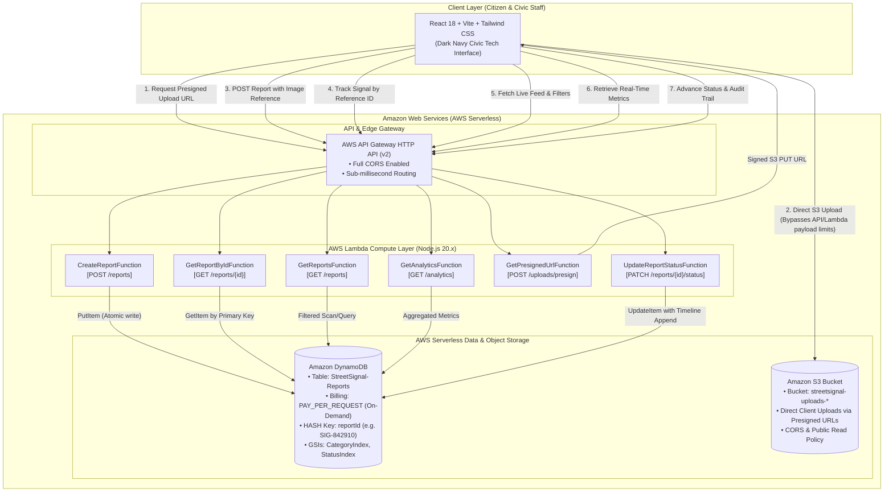

# StreetSignal - Architecture & Cloud Design

## 1. System Overview

**StreetSignal** is a modern, enterprise-grade civic issue reporting and dispatch platform designed on AWS Serverless architecture. The platform empowers citizens to report civic infrastructure defects (Potholes, Garbage, Road Dust, Water Leakages, and Streetlights) with instant unique tracking IDs, direct Amazon S3 photo uploads, and real-time Amazon DynamoDB persistence.

---

## 2. Architecture Diagram

---

## 3. Component Deep Dive

### 3.1 Frontend Layer
- **Framework**: React 18 with Vite for lightning-fast HMR and bundle compilation.
- **Styling**: Tailwind CSS with custom Dark Navy palette (`#070b14`, `#0a0f1d`, `#141f36`) and electric-blue accents (`#00f0ff`, `#38bdf8`).
- **Icons**: Lucide React for consistent, high-contrast civic icons.
- **Direct S3 Integration**: Uploads photos straight to Amazon S3 via authenticated PUT requests, preventing Lambda payload bottlenecking.
- **Resilient Fallback**: Auto-discovers backend endpoints with local mock fallbacks for offline demo resilience.

### 3.2 API Gateway HTTP API
- **Protocol**: HTTP API (v2) for ultra-low latency and 70% cost reduction compared to REST APIs.
- **CORS Configuration**: Supports `GET`, `POST`, `PATCH`, `PUT`, `DELETE`, `OPTIONS` from all authorized web origins.
- **Payload Format**: Version 2.0 with minimal overhead.

### 3.3 AWS Lambda Compute Layer
- **Runtime**: Node.js 20.x on x86_64 architecture.
- **Execution Model**: Single-responsibility microservice handlers ensuring least-privilege IAM isolation.
- **Validation**: Strict input validation for category enums, MIME types, file size (max 5MB), and length limits before database writes.

### 3.4 Amazon DynamoDB (On-Demand)
- **Billing Mode**: `PAY_PER_REQUEST` for zero cold capacity costs and instant elasticity up to thousands of requests/sec.
- **Data Model**:
  - `reportId` (Partition Key, String): Human-readable, memorable IDs (e.g. `SIG-842910`).
  - `category` (String): One of `Potholes`, `Garbage`, `Road Dust`, `Water Leakage`, `Streetlights`.
  - `locality` (String): Municipal zone / street address.
  - `description` (String): Detailed context from citizen.
  - `imageUrl` (String | null): Public S3 asset URL.
  - `priority` (String): `Low`, `Medium`, `High`, `Critical`.
  - `status` (String): `Submitted` -> `Under Review` -> `In Progress` -> `Resolved`.
  - `timeline` (List of Objects): Append-only audit log with timestamp and notes.
  - `createdAt` (ISO String) & `updatedAt` (ISO String).

### 3.5 Amazon S3 Bucket
- **Security**: Public write blocked; direct uploads only permitted with cryptographic presigned URLs generated by Lambda.
- **Lifecycle & CORS**: Configured with CORS rules to permit PUT from web clients and GET for verified image rendering.

---

## 4. Security & Best Practices

1. **Least-Privilege IAM**:
   - `CreateReportFunction` & `UpdateReportStatusFunction`: Granted `DynamoDBCrudPolicy` strictly on the reports table.
   - `GetReportsFunction`, `GetReportByIdFunction`, `GetAnalyticsFunction`: Granted `DynamoDBReadPolicy`.
   - `GetPresignedUrlFunction`: Granted `S3CrudPolicy` strictly on the uploads bucket.
2. **Direct S3 Uploads**:
   - Files are never proxied through Lambda memory or API Gateway limits (10MB/6MB restrictions avoided).
   - Presigned URLs expire strictly in 15 minutes.
3. **Input Sanitization**:
   - File names are sanitized against path traversal (`..`, `/`, special characters).
   - Category strings are checked against strict enumeration lists.
